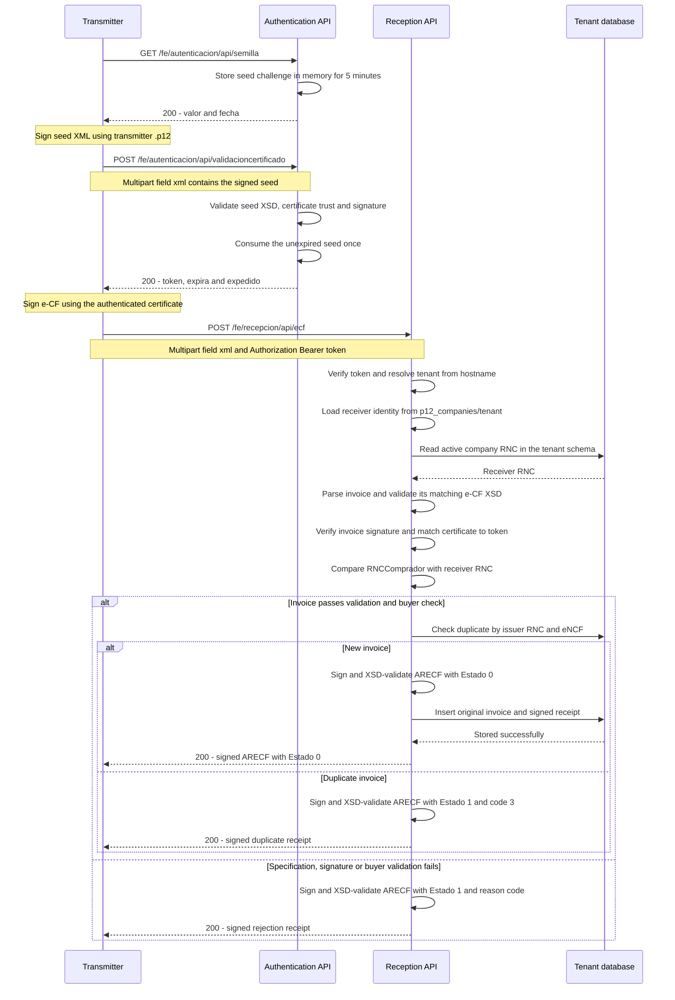

# Electronic invoicing: authentication and reception

The transmitter requests a seed, signs it to obtain an access token, then submits
a signed e-CF using that token. The receiver validates and stores the invoice and
returns a signed acknowledgement (`ARECF`).

## Endpoints

| Method | Path | Input | Successful response |
| --- | --- | --- | --- |
| GET | `/fe/autenticacion/api/semilla` | No body or bearer token | Seed with `valor` and `fecha` |
| POST | `/fe/autenticacion/api/validacioncertificado` | Multipart field `xml`: signed seed | `token`, `expira`, `expedido` |
| POST | `/fe/recepcion/api/ecf` | Multipart field `xml`: signed e-CF; `Authorization: Bearer <token>` | Signed ARECF acknowledgement |

All three endpoints support `Accept: application/xml` and
`Accept: application/json`; XML is the default. Endpoint paths are case insensitive.
`/fe/recepción/api/ecf` is an alias for `/fe/recepcion/api/ecf`.
XML names remain case sensitive and follow the XSDs.

## Flow path

Use the receiver's tenant hostname throughout the flow, for example
`http://ans.localhost:4000`. The transmitter signs the seed and invoice with its
own certificate. The receiver signs acknowledgements with its tenant certificate.



The unique database index also catches concurrent duplicates during insertion;
that request receives a new signed duplicate receipt. Rejected invoices are not
stored. A successful `Estado=0` response is sent only after storage succeeds.

The diagram shows interpretable invoices and available infrastructure. Invalid
tokens, unknown hosts, unreadable uploads and size violations stop processing with
HTTP `401`, `404`, `400` or `413`, respectively. Configuration, verification
availability, signing, receipt-validation or database failures return HTTP `503`
instead of a signed acknowledgement. Authentication errors likewise stop the flow
before a token is issued.

### 1. Request and sign the seed

The server generates a random padded Base64 `valor` and a UTC ISO 8601 `fecha`,
for example `2026-10-25T03:56:12Z`. The transmitter signs the returned XML using
its `.p12` identity, without changing the seed values.

The seed expires after five minutes and can be consumed once. Outstanding seeds
are held in application memory, so a server restart invalidates them.

### 2. Exchange the signed seed for a token

Certificate validation checks the signed seed's structure, XSD, RSA-SHA256
signature and certificate against the configured trusted CA chain. Successful
validation consumes the seed and returns a one-hour FE bearer token.

The token identifies the signing certificate; it is separate from tenant login
tokens. `expira` and `expedido` are UTC ISO 8601 timestamps.

### 3. Submit the signed e-CF

The transmitter signs its invoice and uploads it with the bearer token.
The invoice's signing certificate must match the certificate that authenticated.
The receiver validates the matching e-CF XSD, signature, buyer RNC and duplicates.

The hostname determines the tenant:

| Host | Tenant | Company source | Receiver signing directory |
| --- | --- | --- | --- |
| `ans.localhost:4000` | `ans` | `ans.company` | `p12_companies/ans/` |
| `evofitdb.tigoo.app` | `evofitdb` | `evofitdb.company` | `p12_companies/evofitdb/` |

The receiver RNC is the single distinct RNC among active company records in that
tenant. `RNCComprador` must match it; the incoming XML never selects the tenant.
Each receiver directory contains one `.p12` and `credentials.txt` with a
`Password: ...` field. `FE_RECEIVERS_JSON` and tenant password environment
variables are not used.

Accepted invoices are stored in the tenant's `fe_received_ecfs` table, along with
the signed receipt, signing certificate fingerprint and timestamps. A unique
index on `(issuer_rnc, encf)` prevents duplicates, including concurrent uploads.

## Reception response

XML responses contain the signed `ARECF`. JSON responses contain
`ARECF.DetalleAcusedeRecibo` and `xml`, the complete signed XML string. The JSON
representation itself is not signed.

| Estado | CodigoMotivoNoRecibido | Meaning |
| --- | --- | --- |
| 0 | Omitted | Received and stored |
| 1 | 1 | Specification/XSD error |
| 1 | 2 | Signature error or certificate differs from token |
| 1 | 3 | Duplicate issuer RNC and eNCF |
| 1 | 4 | Buyer RNC does not match receiver |

These signed business acknowledgements use HTTP `200`; callers must inspect
`Estado`. Receipt timestamps use `dd-MM-yyyy HH:mm:ss`, GMT-4. An ARECF confirms
receipt status, not commercial approval or DGII fiscal certification.

Handled reception errors use `400` for unreadable XML or missing identifiers,
`401` for missing/invalid/expired bearer tokens, `404` for unknown tenant hosts,
`413` for XML over 5,000,000 bytes and `503` for unavailable configuration,
verification, signing or storage. Signed seed uploads are limited to 65,536 bytes.

## Quick local check

With the updated server running, tenant migration applied and signing identities
provisioned, run from `server`:

```bash
bash sh/test_fe_end_to_end.sh http://ans.localhost:4000
```

The script reads the receiver RNC from the database, prepares a temporary E31,
signs the seed and invoice, obtains a token, submits the invoice for an XML
receipt, and resubmits it for a JSON duplicate receipt. It prints each response
and reports `PASS` when both expected reception outcomes are observed.

For this local simulation, the tenant certificate acts as both transmitter and
receiver. The sample emitter identity is illustrative. Each successful run stores
one invoice; temporary files are removed on exit. The script uses the existing
build without compiling and resolves `*.localhost` to `127.0.0.1` for curl.

Individual scripts:

| Script | Purpose |
| --- | --- |
| `sh/test_fe_semilla.sh` | Request an XML seed |
| `sh/test_fe_validacioncertificado.sh` | Submit a signed seed |
| `sh/test_fe_recepcion.sh` | Submit a signed invoice with `FE_TOKEN` |
| `sh/test_fe_end_to_end.sh` | Run the complete local sample flow |

See [FE_AUTHENTICATION.md](FE_AUTHENTICATION.md) for certificate/tool setup and
[FE_RECEPTION.md](FE_RECEPTION.md) for receiver provisioning, XSD compatibility
adjustments, migration requirements and implementation limits.
